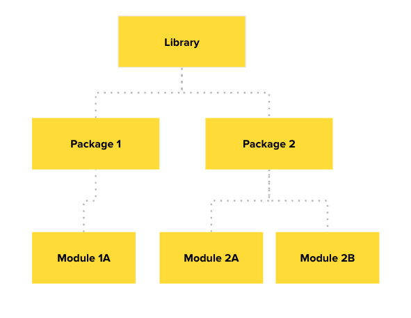

<h1>
  <span class="headline">Python Modules and Scripting</span>
  <span class="subhead">Modules</span>
</h1>

**Learning objective:** By the end of this lesson, students will be able to import and use Python modules, including those from the Standard Library, to extend the functionality of their programs.

| Lesson  | Duration |
| ------- | -------- |
| Modules | 40 min   |

## A Little Help From Our Friends

**Modules** are collections of helpful Python code and functions we can use. Instead of reinventing the wheel, modules provide us with immediate benefits:

- Reliable, heavily tested code.
- Well-known patterns for easy collaboration.
- The ability to focus on your application’s higher-level needs.

> 💡 You will encounter numerous modules that others have written. They are free to use, and you can think of them as extensions of Python's functionality.

## Importing from the Standard Library

Some modules are so commonly used that they are bundled with Python itself.

To get a feel for modules, let’s explore the `random` module. In order to use a module, we first have to import it by including an import statement at the top of our code:

```python
import random

# Now, we can use the random module and its methods, such as randint.

random_die_roll = random.randint(1, 6)
```

> 💡 Other modules may need to be separately downloaded; we'll get to this later. The Python Standard Library will never need to be downloaded separately, it’s always just an import statement away.

## Read the Docs

The downside of borrowing someone else's code is having no idea how to use it — at first, that is!

[Python’s Standard Documentation](https://docs.python.org/3/library/random.html) provides a good place to begin reading up on the `random` module. Other modules may have different documentation sources.

<!--  -->

<br>

<div class="activity solo-exercise">
  <h2 class="title">6.1 Games of Chance</h2>
  <span class="minutes">20 min</span>
</div>

Let’s explore the `random` module using some challenges involving random chance. Read the documentation to discover helpful methods for each task.

<!--  -->

## Library Hierarchy

**Libraries** are large collections of tools that will prove very helpful to you.

These libraries are often organized into one or more **packages**.

Packages can be organized further into one or more **modules**.



## Package Delivery

Libraries, packages, and modules need to be installed in order to use these tools on your computer:

```bash
%pip install library_name
```

<!--  -->

> The `%` sign tells Anaconda/Jupyter to run the line as a shell command.

If you want to import only one module from a package:

```python
from package_name import module
```

> Python package installation can be tricky outside of this context, so hopefully a simple `pip install` in Jupyter Notebook will do the trick.

> Sometimes, a package contains just one module, which is OK. This may seem strange, but will become more familiar over time.

<br>

<div class="activity group-exercise">
  <h2 class="title">6.2 Geocoder Road Trip</h2>
  <span class="minutes">20 min</span>
</div>

Install and use the "geocoder" library for the challenges in **Section 6.2**.

The purpose of this activity is to:

- Understand how easily accessible new libraries are.
- Practice reading documentation given one clear direction.
- Reinforce basic logic skills in Python by using lists and conditionals.

<!--  -->
